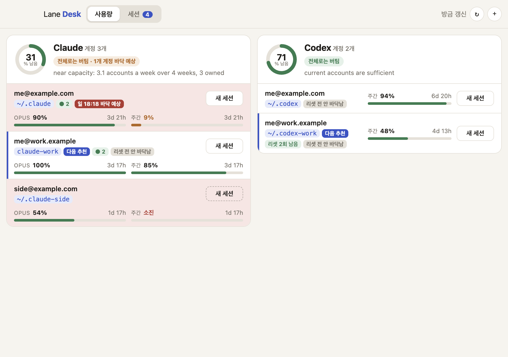
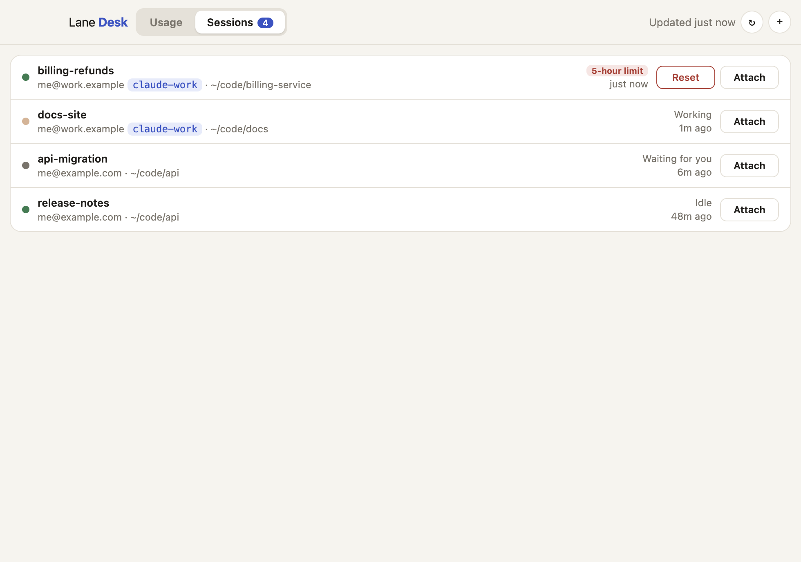

# lane-desk

[English](README.md) · 한국어

Claude Code나 Codex를 계정 여러 개로 쓰는 사람을 위한 macOS 메뉴바 앱입니다. [Tally](https://github.com/jettoai/tally)가 이미 모으는 값을 읽어, 계정마다 얼마나 남았는지와 지금 속도면 언제 바닥나는지를 보여 줍니다. 같은 창에서 원하는 계정으로 새 세션을 열거나, 돌고 있는 세션으로 바로 돌아갑니다.



<sub>스크린샷은 지어낸 계정입니다(`LANE_DESK_DEMO=1`).</sub>

- **메뉴바에 `C31 X71`이 뜹니다.** Claude와 Codex 계정 전체에서 남은 %이고, Tally가 매긴 가중치를 따릅니다. Tally에 계정이 없는 쪽은 메뉴바와 카드에서 뺍니다(`X71`).
- **카드의 판정은 Tally가 계정 전체를 합쳐 낸 것입니다**(「전체로는 버팀」·「전체로는 모자람」). 리셋 전에 바닥날 계정이 있으면 그 수를 덧붙입니다(「전체로는 버팀 · 1개 계정 바닥 예상」).
- **계정별 바닥 예상.** 최근 72시간 동안 계정마다 주간 한도를 얼마나 빨리 썼는지 잽니다. 주간 리셋 전에 바닥날 계정에는 시각이 적힌 빨간 태그(「일 03:25 바닥 예상」)를 붙이고, 아니면 「리셋 전 안 바닥남」을 붙입니다. 알려 주기만 합니다. 알림을 보내거나 계정을 대신 바꾸지 않습니다.
- **새 세션**은 그 계정으로 tmux 세션을 열고 iTerm 새 탭에서 붙습니다. 주간 한도를 다 쓴 계정은 버튼을 흐리게 두지만 막지는 않습니다(곧 리셋될 수 있음). 마우스를 올리면 리셋까지 남은 시간이 나옵니다. tmux가 없으면 버튼을 끄고, 카드 위에 무엇을 설치할지 한 줄로 알려 줍니다.
- **세션 탭**은 지금 돌고 있는 Claude Code 세션을 최근 순으로 보여 줍니다. **붙기**는 그 세션의 tmux 세션을 iTerm으로 엽니다. 이미 어느 창에 붙어 있으면 iTerm만 앞으로 가져옵니다.
- **리셋**은 5시간 한도에 걸린 세션에 나타납니다. 확인을 받은 뒤 그 세션에 `/limit-reset`을 입력하고, Claude Code의 답을 대화 기록에서 읽어 알려 줍니다.



## 필요한 것

- macOS
- 계정을 추가해 둔 [Tally](https://github.com/jettoai/tally). 사용량 숫자는 `tally status --json`과 `~/.tally/history.jsonl`에서만 옵니다. 그 밖에 읽는 것은 [읽는 것](#읽는-것)에 있습니다.
- Node.js 22.12 이상
- 새 세션·붙기·리셋을 쓰려면 [tmux](https://github.com/tmux/tmux) 3.2 이상과 [iTerm2](https://iterm2.com)

## 설치

```
npx lane-desk            # 메뉴바만
npx lane-desk --window   # 창도 바로 열기
```

`npm i -g lane-desk`로 한 번 설치한 뒤 `lane-desk`로 실행해도 됩니다. `npm i -g`는 Electron을 받지 않고, 처음 실행할 때 받습니다(약 120MB, 풀면 260MB). `~/Library/Caches/electron`에 이미 있으면 그것을 씁니다. npm으로 받으면 서명 없는 `.app`을 내려받을 때 뜨는 「확인되지 않은 개발자」 차단 없이 실행됩니다.

전역 설치를 올리려면: 메뉴바 글자 오른쪽 클릭 → 종료, `npm i -g lane-desk@latest`, `lane-desk` 순서로 합니다. 오른쪽 클릭 메뉴 맨 위 줄에 지금 도는 판 번호가 있습니다.

clone해서 쓸 때:

```
git clone https://github.com/robfold/lane-desk.git
cd lane-desk
npm install
bin/lane-desk --window
```

메뉴바 글자를 누르면 팝오버가 열립니다. 오른쪽 클릭 메뉴에 「창으로 열기」가 있습니다. 창에서 `⌘N`은 새 창, `⌘T`는 새 탭입니다. 메뉴바가 꽉 차면 글자가 노치 뒤에 가려질 수 있습니다. 그때는 `npx lane-desk --window`로 창을 바로 엽니다.

연결하기 전에 먼저 보고 싶다면 `LANE_DESK_DEMO=1 npx lane-desk --window`로 지어낸 계정 화면을 엽니다. 이미 떠 있는 Lane Desk 옆에 따로 열리고, 메뉴바 글자 앞에 `Demo`가 붙습니다. Tally가 없으면 Lane Desk는 Tally 링크와 이 명령을 담은 안내 화면으로 열립니다. Tally가 있는데 실패하면 실행한 명령과 에러를 보여 줍니다.

## 세션을 여는 명령

기본은 계정의 CLI를 그 계정 폴더로 실행하는 것입니다.

| 계정 폴더(Tally 기준) | tmux에서 실행하는 것 |
|---|---|
| `~/.claude` | `claude` |
| `~/.claude-work` | `CLAUDE_CONFIG_DIR=~/.claude-work`로 `claude` |
| `~/.codex` | `codex` |
| `~/.codex-work` | `CODEX_HOME=~/.codex-work`로 `codex` |

계정마다 따로 만든 실행 명령이 이미 있다면 `~/.config/lane-desk/config.json`에 폴더와 명령을 짝지어 둡니다.

```json
{
  "lanes": {
    "~/.claude-work": "claude-work",
    "~/.codex-work": "codex-work"
  }
}
```

값은 `PATH`에 있는 명령 이름 하나여야 합니다. 그 밖의 값은 무시합니다. 창은 계정 ID만 보내고, 실행할 명령은 main 프로세스가 이 파일에서 고릅니다.

## 바닥 예상 계산

Tally는 계정 사용량이 바뀔 때마다 `~/.tally/history.jsonl`에 한 줄을 붙입니다. Lane Desk는 그 끝 512KB(약 일주일)를 읽습니다.

1. **쓴 양.** 계정의 주간 창에서 최근 72시간 동안 `used`가 오른 만큼을 더합니다. Tally의 소모량 계산(`UsageAdvisorMath.consumption`)을 JavaScript로 옮겼습니다. 리셋 시각이 1분씩 흔들리는 것, 지난 주기 값이 한 번 끼는 것, 리셋 시각은 그대로인데 카운터가 다시 시작하는 것을 거릅니다.
2. **속도.** 쓴 양 ÷ 기록이 덮은 시간(72시간, 기록 전체가 짧으면 그만큼). Tally처럼 시간은 계정의 첫 줄이 아니라 기록 전체의 시작부터 셉니다. Tally는 값이 바뀔 때만 한 줄을 쓰므로, 조용한 계정의 첫 줄은 그 계정이 언제 시작했는지 알려 주지 않기 때문입니다. 그래서 한 시간 전에 추가한 계정은 며칠이 쌓일 때까지 느리게 보입니다. 기록이 6시간 미만이면 「바닥 예상 측정 중」입니다. Tally의 전체 예측(`FleetForecast.weeklyRates`) 틀을 계정 단위로 적용했습니다.
3. **바닥 시각.** 지금 + 남은 % ÷ 속도. 주간 리셋보다 이르면 빨간 태그를 붙입니다.

예상은 "지금까지처럼 쓰면"의 값입니다. Tally가 새 세션을 한 계정에 몰아주면 그 계정은 빨라지고 다른 계정은 느려집니다.

## 리셋(`/limit-reset`)

Claude Code는 `/limit-reset`으로 세션의 5시간 한도를 주 1회 풀어 줍니다. 주간 한도는 그대로입니다. API가 없어서 상태는 두 곳에서 정합니다.

1. **Lane Desk가 직접 본 것.** Claude Code가 대화 기록에 직접 쓴 것만 읽습니다. 명령 출력과 한도 안내입니다. 대화 본문은 그 문장을 인용할 수 있어 읽지 않습니다.
2. **Tally의 `resetState`.** `tally status --json`은 계정마다 `available`, `used`, `notSupported`, `unknown` 중 하나를 줍니다. Lane Desk는 직접 본 것이 없을 때만 `used`와 `available`을 씁니다. `notSupported`는 쓰지 않습니다. Claude에서는 관찰이 없고 캐시된 롤아웃 플래그가 꺼져 있을 때 나오는 값인데, 이 플래그는 한 시간 안에도 켜짐과 꺼짐을 오갑니다.

- 계정에 `리셋 남음`, `리셋 씀 · 2d 4h 뒤`(Tally 값처럼 다음 날짜를 모르면 `리셋 씀`), `리셋 없음`(이 로그인의 대화 기록에서 Claude Code가 Unknown command로 답함) 중 하나를 붙입니다. 태그에 마우스를 올리면 어느 쪽 근거인지 보입니다.
- 둘 다 모르면 태그를 붙이지 않습니다. Tally도 `unknown`이면 아무것도 그리지 않습니다.
- 버튼은 세 조건을 모두 만족할 때만 눌립니다. 세션이 대기 상태, 이번 주 리셋을 썼다고 확인되지 않음(태그가 없는 계정도 포함), 주간 잔량 20% 이상입니다. 20%는 Tally와 같은 기준입니다. 그 아래면 곧 주간 한도에 걸립니다.
- tmux 창이 스크롤 모드면 입력하지 않습니다. 입력 직전에 세션 상태를 한 번 더 봅니다.
- 아직 관찰하지 못한 것: 성공 문장. 지금까지 본 실제 답은 한도에 걸리지 않은 세션에서 나온 "A 5-hour limit reset isn't available right now." 하나입니다.

**Codex** 계정은 주간 한도를 다시 채우는 리셋을 적립해 둘 수 있습니다. Tally가 적립분을 알려 주면(`resetCreditsAvailable`이 0보다 큼) 계정에 `리셋 2회 남음` 같은 태그를 붙입니다. 마우스를 올리면 가장 빠른 만료 시각이, 만료가 알려지지 않았으면 그렇다는 문장이 나옵니다. Lane Desk는 보여 주기만 하고 리셋을 쓰지 않습니다.

## 읽는 것

- `tally status --json`(계정, 사용량, Tally 추천, 계정별 `resetState`)과 `~/.tally/history.jsonl`
- 있으면 `~/.config/lane-desk/config.json`
- Tally가 아는 Claude 계정 폴더마다: `sessions/<pid>.json`(pid·이름·폴더·상태·tmux 창만 남김), `/limit-reset` 답과 한도 안내를 찾기 위한 최근 8일 대화 기록(`projects/*/*.jsonl`), `.claude.json`에 캐시된 롤아웃 값 하나

Keychain, 토큰, 세션 `.key` 파일, 프로세스 인자는 읽지 않고, 네트워크 요청도 하지 않습니다. 계정 정보를 공유하거나 묶어 쓰지 않습니다. 계정을 어떻게 쓰는지는 각 서비스 약관을 따르세요.

## 설정

| 변수 | 하는 일 |
|---|---|
| `LANE_DESK_LANG=en` 또는 `ko` | 언어. 기본은 시스템 언어(한국어면 한국어, 아니면 영어) |
| `LANE_DESK_CONFIG` | `config.json`의 다른 경로 |
| `TALLY_BIN` | `tally` CLI 경로. 기본은 `PATH`의 `tally`, 없으면 `/Applications/Tally.app/Contents/Helpers/tally` |
| `LANE_DESK_HISTORY` | Tally `history.jsonl`의 다른 경로 |
| `LANE_DESK_DEMO=1` | Tally 대신 지어낸 계정 |
| `LANE_DESK_CAPTURE=<폴더>` | 팝오버·사용량 창·세션 창을 띄우지 않고 PNG로 찍은 뒤 끝냄 |

## 이번 판에 없는 것

- 세션 탭의 Codex 세션. Codex는 프로세스별 세션 파일을 남기지 않아 찾을 근거가 없습니다.
- 서명된 `.app`. `npx lane-desk`나 clone한 폴더에서 실행합니다.

## 다른 도구가 나은 경우

- **가장 좋은 계정을 골라 바로 실행만 하면 될 때:** Tally가 혼자 합니다(`tally claude`, `tally codex`). Lane Desk는 계정별 바닥 예상과 세션 목록을 더합니다.
- **Tally 없이 여러 서비스를 볼 때:** [CodexBar](https://github.com/steipete/CodexBar)가 Claude·Codex 등의 사용량을 메뉴바에 보여 줍니다.

## 개발

```
npm test
```

배포는 GitHub Actions가 합니다. `package.json` 버전과 같은 태그를 push하면(`git tag v0.1.1 && git push origin v0.1.1`) [`publish.yml`](.github/workflows/publish.yml)이 테스트한 뒤 npm 신뢰 배포(OIDC)로 올립니다. npm 토큰은 어디에도 저장하지 않습니다.

테스트는 순수 함수 부분(실행 명령, 화면 값, 바닥 예상, `/limit-reset` 답 읽기)을 다룹니다. tmux·iTerm·화면에 닿는 부분은 손으로 확인했습니다.

## 출처

jetto의 [Tally](https://github.com/jettoai/tally)(MIT) 위에 만들었습니다. 바닥 예상과 `/limit-reset` 신호는 Tally 소스를 따릅니다. [NOTICE](NOTICE)를 보세요.

## 라이선스

[MIT](LICENSE)
