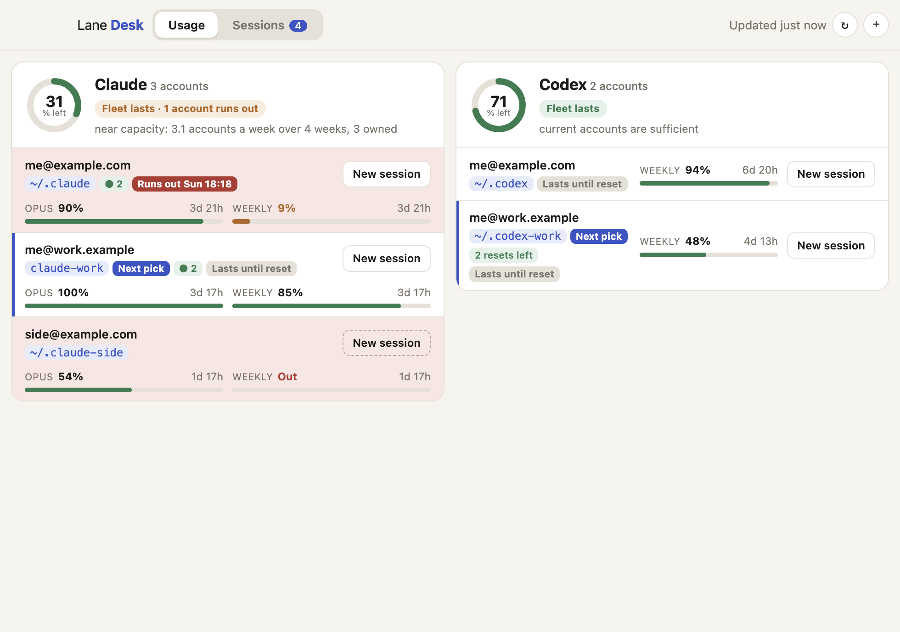
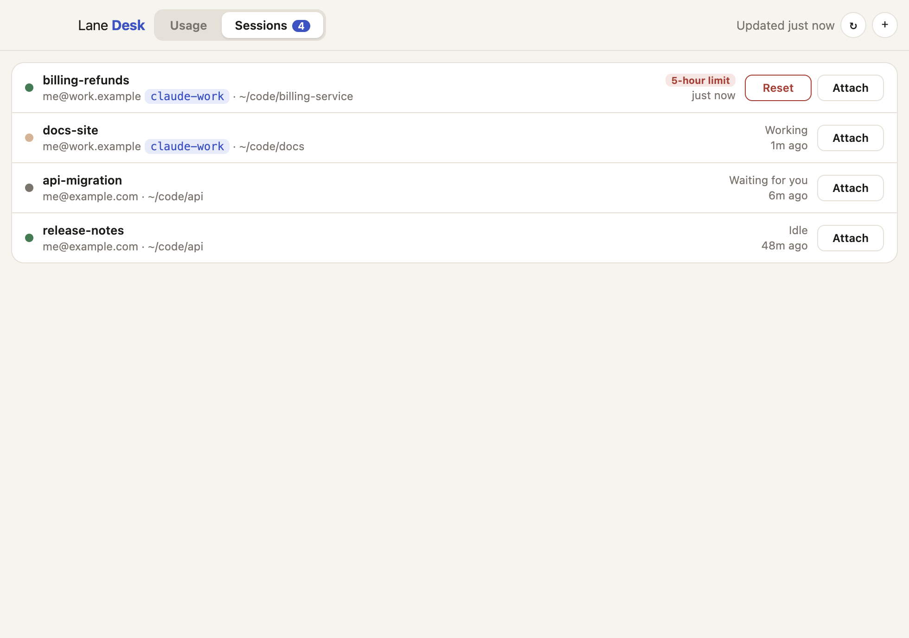

# lane-desk

English · [한국어](README.ko.md)

A macOS menu bar app for people who use Claude Code or Codex on more than one account. It reads what [Tally](https://github.com/jettoai/tally) already tracks and shows, per account, how much is left and when it runs out at your current pace. From the same window you start a session on any account, or jump back into one that is running.



<sub>Screenshots use made-up accounts (`LANE_DESK_DEMO=1`).</sub>

- **The menu bar shows `C31 X71`**: Claude and Codex, percent left across all your accounts, as Tally weighs them.
- **Run-out forecast per account.** It measures how fast each account spent its weekly limit over the last 72 hours. If the account will run out before its weekly reset, it gets a red tag with the time ("Runs out Sun 03:25"). Otherwise the tag says "Lasts until reset". It only tells you. It sends no notification and never switches accounts for you.
- **New session** opens a tmux session on that account and attaches to it in a new iTerm tab.
- **Sessions tab** lists the Claude Code sessions running now, newest first. **Attach** opens the session's tmux session in iTerm, or brings iTerm forward if a window is already attached.
- **Reset** appears on a session stuck at its 5-hour limit. It types `/limit-reset` into that session after you confirm, then reads Claude Code's answer from the transcript.



## Requirements

- macOS
- [Tally](https://github.com/jettoai/tally) running, with your accounts added. Usage numbers come only from `tally status --json` and `~/.tally/history.jsonl`; see [What it reads](#what-it-reads) for the rest.
- Node.js 22.12 or later
- For New session, Attach, and Reset: [tmux](https://github.com/tmux/tmux) 3.2 or later and [iTerm2](https://iterm2.com)

## Install

```
npx lane-desk            # menu bar only
npx lane-desk --window   # also open a window
```

Or install it once with `npm i -g lane-desk` and run `lane-desk`. The first run downloads Electron (about 110 MB). Installed from npm, it runs without the "unidentified developer" prompt that an unsigned `.app` download gets.

From a clone:

```
git clone https://github.com/robfold/lane-desk.git
cd lane-desk
npm install
bin/lane-desk --window
```

Click the menu bar title for the popover. Right-click it for "Open as Window". In a window, `⌘N` opens a new window and `⌘T` a new tab.

Want to look before you connect anything? `LANE_DESK_DEMO=1 npx lane-desk --window` opens the window with made-up accounts.

## Starting sessions

By default, New session runs the account's own CLI with its folder:

| Account folder (from Tally) | What runs in tmux |
|---|---|
| `~/.claude` | `claude` |
| `~/.claude-work` | `claude` with `CLAUDE_CONFIG_DIR=~/.claude-work` |
| `~/.codex` | `codex` |
| `~/.codex-work` | `codex` with `CODEX_HOME=~/.codex-work` |

If you already have one wrapper command per account, map folders to commands in `~/.config/lane-desk/config.json`:

```json
{
  "lanes": {
    "~/.claude-work": "claude-work",
    "~/.codex-work": "codex-work"
  }
}
```

A value must be a bare command name on your `PATH`. Anything else is ignored. The window only sends an account ID; the command is picked in the main process from this file.

## How the forecast works

Tally appends a line to `~/.tally/history.jsonl` each time an account's usage moves. Lane Desk reads the last 512 KB (about a week).

1. **Spent.** For each account's weekly window, it adds up how much `used` went up in the last 72 hours. This is a JavaScript port of Tally's own consumption walk (`UsageAdvisorMath.consumption`). It ignores reset times that drift by a minute, a one-poll reading from the previous cycle, and a counter that restarts without its reset time moving.
2. **Pace.** Spent ÷ hours covered (72, or less when the whole history is shorter). Like Tally, the hours count from the start of the history, not from an account's first line: Tally writes a line only when a value moves, so a quiet account's first line says nothing about when it started. An account added an hour ago therefore reads slow until it has a few days behind it. With under 6 hours of history it says "Measuring pace". This is the frame of Tally's fleet forecast (`FleetForecast.weeklyRates`), done per account instead of for the whole fleet.
3. **Run-out time.** Now + percent left ÷ pace. If that comes before the weekly reset, the account gets the red tag.

The forecast assumes you keep using each account the way you did. If Tally starts sending all new sessions to one account, that account speeds up and the others slow down.

## About Reset (`/limit-reset`)

Claude Code can lift a session's 5-hour limit once a week with `/limit-reset`. The weekly limit stays. There is no API for it, so Lane Desk only reads what Claude Code itself writes to the transcript: the command's output and limit notices. It does not read the conversation, which can quote those sentences.

- Accounts get a tag: `Reset ?` (not seen yet), `Reset left`, `Reset used · 2d 4h`, or `No reset` (Claude Code answered "Unknown command").
- The button works only when the session is idle, this week's reset is not known to be used (`Reset ?` counts), and the account has at least 20% weekly left (Tally's rule: below that, the weekly wall comes soon anyway).
- It does not type into a tmux pane in scroll mode, and it checks the session again right before typing.
- Not seen yet: the success sentence. The only real answer observed so far is "A 5-hour limit reset isn't available right now." from a session that was not at its limit.

## What it reads

- `tally status --json` and `~/.tally/history.jsonl`
- `~/.config/lane-desk/config.json`, if present
- For each Claude account folder Tally knows: `sessions/<pid>.json` (pid, name, folder, status, tmux pane; nothing else is kept), the last 8 days of transcripts (`projects/*/*.jsonl`) for `/limit-reset` answers and limit notices, and one cached rollout value in `.claude.json`

It does not read Keychain, tokens, session `.key` files, or process arguments, and it makes no network requests. It never shares or pools credentials; how you use your accounts is between you and your providers' terms.

## Settings

| Variable | What it does |
|---|---|
| `LANE_DESK_LANG=en` or `ko` | Language. Default: your system language (Korean if it is Korean, otherwise English) |
| `LANE_DESK_CONFIG` | Another path for `config.json` |
| `TALLY_BIN` | Path to the `tally` CLI. Default: `tally` on `PATH`, then `/Applications/Tally.app/Contents/Helpers/tally` |
| `LANE_DESK_HISTORY` | Another path for Tally's `history.jsonl` |
| `LANE_DESK_DEMO=1` | Made-up accounts instead of Tally |
| `LANE_DESK_CAPTURE=<folder>` | Render the popover, the Usage window, and the Sessions window to PNG without showing them, then quit |

## Not in this version

- Codex sessions in the Sessions tab. Codex writes no per-process session file to find them by.
- A signed `.app`. Run it with `npx lane-desk` or from a clone.

## When to use something else

- **Just picking the best account and launching on it:** Tally does that on its own (`tally claude`, `tally codex`). Lane Desk adds the per-account forecast and the session list.
- **Many providers, without Tally:** [CodexBar](https://github.com/steipete/CodexBar) shows usage for Claude, Codex, and others in the menu bar.

## Development

```
npm test
```

The tests cover the pure parts: lanes, the view, the forecast, and reading `/limit-reset` answers. Anything that touches tmux, iTerm, or the screen was checked by hand.

## Credits

Built on top of [Tally](https://github.com/jettoai/tally) by jetto (MIT). The forecast and the `/limit-reset` signals follow Tally's source; see [NOTICE](NOTICE).

## License

[MIT](LICENSE)
